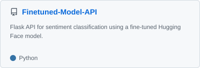
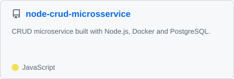
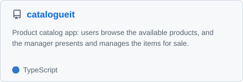
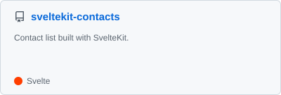
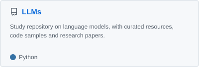
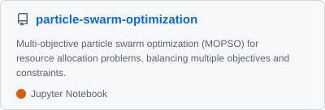

<picture><source media="(prefers-color-scheme: dark)" srcset="./img/hero-dark.svg"></picture>

<a href="https://github.com/pachecowillians"><picture><source media="(prefers-color-scheme: dark)" srcset="./img/contact/github-dark.svg"></picture></a>&nbsp;
<a href="https://www.linkedin.com/in/pachecowillians/"><picture><source media="(prefers-color-scheme: dark)" srcset="./img/contact/linkedin-dark.svg"></picture></a>&nbsp;
<a href="mailto:willianpacheco31@gmail.com"><picture><source media="(prefers-color-scheme: dark)" srcset="./img/contact/email-dark.svg"></picture></a>&nbsp;
<a href="https://pachecowillians.github.io/"><picture><source media="(prefers-color-scheme: dark)" srcset="./img/contact/portfolio-dark.svg"></picture></a>&nbsp;
<a href="http://lattes.cnpq.br/1561732707542523"><picture><source media="(prefers-color-scheme: dark)" srcset="./img/contact/lattes-dark.svg"></picture></a>&nbsp;
<a href="https://orcid.org/0009-0004-4888-9408"><picture><source media="(prefers-color-scheme: dark)" srcset="./img/contact/orcid-dark.svg"></picture></a>

I'm a <strong>software engineer</strong> who works full stack and full cycle, from architecture and back-end to front-end and cloud infrastructure, with attention to scalable systems and clear engineering standards.

I started programming in 2015, at 14, studying on my own, and then took the SENAI technical course. I completed Computer Engineering at UFES in 2023 and a <strong>Master's in Electrical Engineering</strong> in 2026, with a dissertation on AI and sensor fusion with FBG sensors and four published papers in machine learning and optimization. Along the way I grew into a technical leadership role, and today I also teach mathematics, programming and music on occasion, and run my own technology company, <strong>Loomis</strong>.

The full story, publications and projects are in my <a href="https://pachecowillians.github.io/">portfolio</a>.

## What I bring

<table>
<tr>
<td valign="top" width="33%">
<b>Back-end and cloud</b>
  
Services and apps on AWS, in Python, Node.js, React and Next.js: Linux servers on EC2, microservices on ECS Fargate, provisioning with Terraform and CloudFormation. Docker, CI/CD and APIs with FastAPI and Swagger. Git on GitHub and GitLab.
  
           
</td>
<td valign="top" width="33%">
<b>Machine learning and research</b>
  
Applied research in sensor fusion with FBG sensors, using neural networks, LLMs and time series. In software development, I use LLMs and AI agents, with Claude and Codex, for implementation and review.
  
    
</td>
<td valign="top" width="33%">
<b>Front-end</b>
  
Interfaces in React, Next.js, SvelteKit and TypeScript, with HTML, CSS and Sass, and design in Figma. Projects include a Pomodoro timer, a WhatsApp Web clone, a product catalog and a contact list.
  
        
</td>
</tr>
</table>

## Selected work

<a href="https://github.com/pachecowillians/Finetuned-Model-API"><picture><source media="(prefers-color-scheme: dark)" srcset="./img/repos/finetuned-model-api-dark.svg"></picture></a>
<a href="https://github.com/pachecowillians/node-crud-microsservice"><picture><source media="(prefers-color-scheme: dark)" srcset="./img/repos/node-crud-microsservice-dark.svg"></picture></a>
<a href="https://github.com/pachecowillians/catalogueit"><picture><source media="(prefers-color-scheme: dark)" srcset="./img/repos/catalogueit-dark.svg"></picture></a>
<a href="https://github.com/pachecowillians/sveltekit-contacts"><picture><source media="(prefers-color-scheme: dark)" srcset="./img/repos/sveltekit-contacts-dark.svg"></picture></a>
<a href="https://github.com/pachecowillians/LLMs"><picture><source media="(prefers-color-scheme: dark)" srcset="./img/repos/llms-dark.svg"></picture></a>
<a href="https://github.com/pachecowillians/particle-swarm-optimization"><picture><source media="(prefers-color-scheme: dark)" srcset="./img/repos/particle-swarm-optimization-dark.svg"></picture></a>

## Work with me

<picture><source media="(prefers-color-scheme: dark)" srcset="./img/loomis/logo-dark.svg"></picture>

**Custom software, from design to production.**

Loomis Desenvolvimento de Softwares Ltda. is my software development and architecture company, which I founded on January 12, 2026.

<table>
<tr>
<td valign="top" width="25%">
<picture><source media="(prefers-color-scheme: dark)" srcset="./img/loomis/strategy-dark.svg"></picture>
 
<b>Strategy</b>
 
Technical decisions tied to business goals.
</td>
<td valign="top" width="25%">
<picture><source media="(prefers-color-scheme: dark)" srcset="./img/loomis/architecture-dark.svg"></picture>
 
<b>Architecture</b>
 
Well-structured systems, easy to maintain and evolve.
</td>
<td valign="top" width="25%">
<picture><source media="(prefers-color-scheme: dark)" srcset="./img/loomis/build-dark.svg"></picture>
 
<b>Build</b>
 
Implementation of back-end services and web applications.
</td>
<td valign="top" width="25%">
<picture><source media="(prefers-color-scheme: dark)" srcset="./img/loomis/evolution-dark.svg"></picture>
 
<b>Evolution</b>
 
Continuous maintenance and improvement of what runs in production.
</td>
</tr>
</table>

<a href="mailto:contato.loomis@gmail.com?subject=Loomis"><picture><source media="(prefers-color-scheme: dark)" srcset="./img/loomis/talk-dark.svg"></picture></a>

