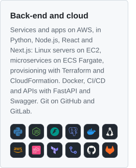
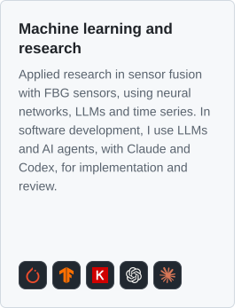
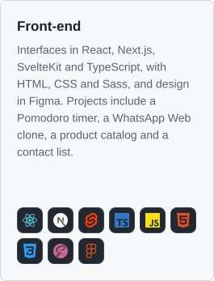
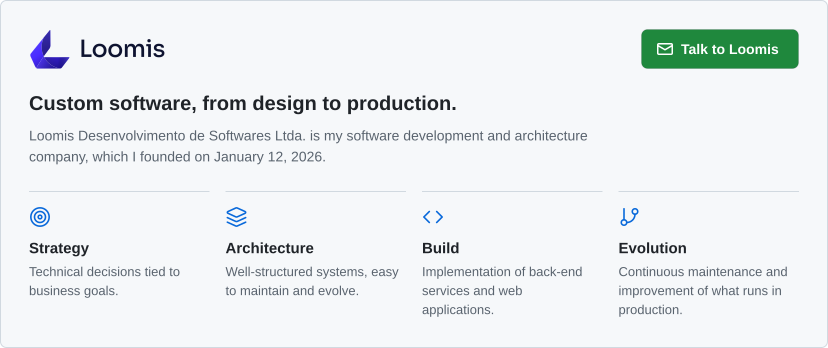

<picture><source media="(prefers-color-scheme: dark)" srcset="./img/hero-dark.svg"></picture>

<a href="https://github.com/pachecowillians"><picture><source media="(prefers-color-scheme: dark)" srcset="./img/contact/github-dark.svg"></picture></a><a href="https://www.linkedin.com/in/pachecowillians/"><picture><source media="(prefers-color-scheme: dark)" srcset="./img/contact/linkedin-dark.svg"></picture></a><a href="mailto:willianpacheco31@gmail.com"><picture><source media="(prefers-color-scheme: dark)" srcset="./img/contact/email-dark.svg"></picture></a><a href="https://pachecowillians.github.io/"><picture><source media="(prefers-color-scheme: dark)" srcset="./img/contact/portfolio-dark.svg"></picture></a><a href="http://lattes.cnpq.br/1561732707542523"><picture><source media="(prefers-color-scheme: dark)" srcset="./img/contact/lattes-dark.svg"></picture></a><a href="https://orcid.org/0009-0004-4888-9408"><picture><source media="(prefers-color-scheme: dark)" srcset="./img/contact/orcid-dark.svg"></picture></a>

I'm a <strong>software engineer</strong> who works full stack and full cycle, from architecture and back-end to front-end and cloud infrastructure, with attention to scalable systems and clear engineering standards.

I started programming in 2015, at 14, studying on my own, and then took the SENAI technical course. I completed Computer Engineering at UFES in 2023 and a <strong>Master's in Electrical Engineering</strong> in 2026, with a dissertation on AI and sensor fusion with FBG sensors and four published papers in machine learning and optimization. Along the way I grew into a technical leadership role, and today I also teach mathematics, programming and music on occasion, and run my own technology company, <strong>Loomis</strong>.

The full story, publications and projects are in my <a href="https://pachecowillians.github.io/">portfolio</a>.

## What I bring

<picture><source media="(prefers-color-scheme: dark)" srcset="./img/bring-1-dark.svg"></picture><picture><source media="(prefers-color-scheme: dark)" srcset="./img/bring-2-dark.svg"></picture><picture><source media="(prefers-color-scheme: dark)" srcset="./img/bring-3-dark.svg"></picture>

## Work with me

<a href="mailto:contato.loomis@gmail.com?subject=Loomis"><picture><source media="(prefers-color-scheme: dark)" srcset="./img/loomis-dark.svg"></picture></a>

