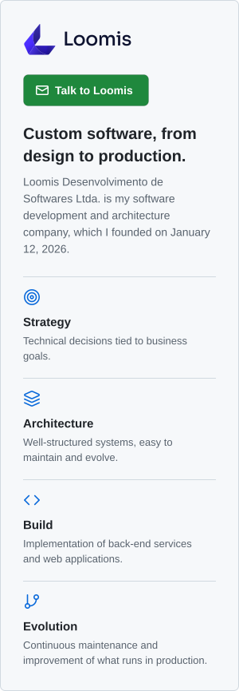

<picture><source media="(min-width: 1136px) and (prefers-color-scheme: dark)" srcset="./img/hero-desk-dark.svg"><source media="(min-width: 1136px)" srcset="./img/hero-desk-light.svg"><source media="(min-width: 1012px) and (prefers-color-scheme: dark)" srcset="./img/hero-mid-dark.svg"><source media="(min-width: 1012px)" srcset="./img/hero-mid-light.svg"><source media="(min-width: 768px) and (prefers-color-scheme: dark)" srcset="./img/hero-mobile-dark.svg"><source media="(min-width: 768px)" srcset="./img/hero-mobile-light.svg"><source media="(min-width: 641px) and (prefers-color-scheme: dark)" srcset="./img/hero-mid-dark.svg"><source media="(min-width: 641px)" srcset="./img/hero-mid-light.svg"><source media="(prefers-color-scheme: dark)" srcset="./img/hero-mobile-dark.svg"></picture>

<a href="https://github.com/pachecowillians"><picture><source media="(min-width: 1280px) and (prefers-color-scheme: dark)" srcset="./img/contact/github-desk-dark.svg"><source media="(min-width: 1280px)" srcset="./img/contact/github-desk-light.svg"><source media="(min-width: 1012px) and (prefers-color-scheme: dark)" srcset="./img/contact/github-lg-dark.svg"><source media="(min-width: 1012px)" srcset="./img/contact/github-lg-light.svg"><source media="(min-width: 768px) and (prefers-color-scheme: dark)" srcset="./img/contact/github-mid-dark.svg"><source media="(min-width: 768px)" srcset="./img/contact/github-mid-light.svg"><source media="(min-width: 641px) and (prefers-color-scheme: dark)" srcset="./img/contact/github-tab-dark.svg"><source media="(min-width: 641px)" srcset="./img/contact/github-tab-light.svg"><source media="(min-width: 481px) and (prefers-color-scheme: dark)" srcset="./img/contact/github-mid-dark.svg"><source media="(min-width: 481px)" srcset="./img/contact/github-mid-light.svg"><source media="(prefers-color-scheme: dark)" srcset="./img/contact/github-mobile-dark.svg"></picture></a>&#8203;<a href="https://www.linkedin.com/in/pachecowillians/"><picture><source media="(min-width: 1280px) and (prefers-color-scheme: dark)" srcset="./img/contact/linkedin-desk-dark.svg"><source media="(min-width: 1280px)" srcset="./img/contact/linkedin-desk-light.svg"><source media="(min-width: 1012px) and (prefers-color-scheme: dark)" srcset="./img/contact/linkedin-lg-dark.svg"><source media="(min-width: 1012px)" srcset="./img/contact/linkedin-lg-light.svg"><source media="(min-width: 768px) and (prefers-color-scheme: dark)" srcset="./img/contact/linkedin-mid-dark.svg"><source media="(min-width: 768px)" srcset="./img/contact/linkedin-mid-light.svg"><source media="(min-width: 641px) and (prefers-color-scheme: dark)" srcset="./img/contact/linkedin-tab-dark.svg"><source media="(min-width: 641px)" srcset="./img/contact/linkedin-tab-light.svg"><source media="(min-width: 481px) and (prefers-color-scheme: dark)" srcset="./img/contact/linkedin-mid-dark.svg"><source media="(min-width: 481px)" srcset="./img/contact/linkedin-mid-light.svg"><source media="(prefers-color-scheme: dark)" srcset="./img/contact/linkedin-mobile-dark.svg"></picture></a>&#8203;<a href="mailto:willianpacheco31@gmail.com"><picture><source media="(min-width: 1280px) and (prefers-color-scheme: dark)" srcset="./img/contact/email-desk-dark.svg"><source media="(min-width: 1280px)" srcset="./img/contact/email-desk-light.svg"><source media="(min-width: 1012px) and (prefers-color-scheme: dark)" srcset="./img/contact/email-lg-dark.svg"><source media="(min-width: 1012px)" srcset="./img/contact/email-lg-light.svg"><source media="(min-width: 768px) and (prefers-color-scheme: dark)" srcset="./img/contact/email-mid-dark.svg"><source media="(min-width: 768px)" srcset="./img/contact/email-mid-light.svg"><source media="(min-width: 641px) and (prefers-color-scheme: dark)" srcset="./img/contact/email-tab-dark.svg"><source media="(min-width: 641px)" srcset="./img/contact/email-tab-light.svg"><source media="(min-width: 481px) and (prefers-color-scheme: dark)" srcset="./img/contact/email-mid-dark.svg"><source media="(min-width: 481px)" srcset="./img/contact/email-mid-light.svg"><source media="(prefers-color-scheme: dark)" srcset="./img/contact/email-mobile-dark.svg"></picture></a>&#8203;<a href="https://pachecowillians.github.io/"><picture><source media="(min-width: 1280px) and (prefers-color-scheme: dark)" srcset="./img/contact/portfolio-desk-dark.svg"><source media="(min-width: 1280px)" srcset="./img/contact/portfolio-desk-light.svg"><source media="(min-width: 1012px) and (prefers-color-scheme: dark)" srcset="./img/contact/portfolio-lg-dark.svg"><source media="(min-width: 1012px)" srcset="./img/contact/portfolio-lg-light.svg"><source media="(min-width: 768px) and (prefers-color-scheme: dark)" srcset="./img/contact/portfolio-mid-dark.svg"><source media="(min-width: 768px)" srcset="./img/contact/portfolio-mid-light.svg"><source media="(min-width: 641px) and (prefers-color-scheme: dark)" srcset="./img/contact/portfolio-tab-dark.svg"><source media="(min-width: 641px)" srcset="./img/contact/portfolio-tab-light.svg"><source media="(min-width: 481px) and (prefers-color-scheme: dark)" srcset="./img/contact/portfolio-mid-dark.svg"><source media="(min-width: 481px)" srcset="./img/contact/portfolio-mid-light.svg"><source media="(prefers-color-scheme: dark)" srcset="./img/contact/portfolio-mobile-dark.svg"></picture></a>&#8203;<a href="https://lattes.cnpq.br/1561732707542523"><picture><source media="(min-width: 1280px) and (prefers-color-scheme: dark)" srcset="./img/contact/lattes-desk-dark.svg"><source media="(min-width: 1280px)" srcset="./img/contact/lattes-desk-light.svg"><source media="(min-width: 1012px) and (prefers-color-scheme: dark)" srcset="./img/contact/lattes-lg-dark.svg"><source media="(min-width: 1012px)" srcset="./img/contact/lattes-lg-light.svg"><source media="(min-width: 768px) and (prefers-color-scheme: dark)" srcset="./img/contact/lattes-mid-dark.svg"><source media="(min-width: 768px)" srcset="./img/contact/lattes-mid-light.svg"><source media="(min-width: 641px) and (prefers-color-scheme: dark)" srcset="./img/contact/lattes-tab-dark.svg"><source media="(min-width: 641px)" srcset="./img/contact/lattes-tab-light.svg"><source media="(min-width: 481px) and (prefers-color-scheme: dark)" srcset="./img/contact/lattes-mid-dark.svg"><source media="(min-width: 481px)" srcset="./img/contact/lattes-mid-light.svg"><source media="(prefers-color-scheme: dark)" srcset="./img/contact/lattes-mobile-dark.svg"></picture></a>&#8203;<a href="https://orcid.org/0009-0004-4888-9408"><picture><source media="(min-width: 1280px) and (prefers-color-scheme: dark)" srcset="./img/contact/orcid-desk-dark.svg"><source media="(min-width: 1280px)" srcset="./img/contact/orcid-desk-light.svg"><source media="(min-width: 1012px) and (prefers-color-scheme: dark)" srcset="./img/contact/orcid-lg-dark.svg"><source media="(min-width: 1012px)" srcset="./img/contact/orcid-lg-light.svg"><source media="(min-width: 768px) and (prefers-color-scheme: dark)" srcset="./img/contact/orcid-mid-dark.svg"><source media="(min-width: 768px)" srcset="./img/contact/orcid-mid-light.svg"><source media="(min-width: 641px) and (prefers-color-scheme: dark)" srcset="./img/contact/orcid-tab-dark.svg"><source media="(min-width: 641px)" srcset="./img/contact/orcid-tab-light.svg"><source media="(min-width: 481px) and (prefers-color-scheme: dark)" srcset="./img/contact/orcid-mid-dark.svg"><source media="(min-width: 481px)" srcset="./img/contact/orcid-mid-light.svg"><source media="(prefers-color-scheme: dark)" srcset="./img/contact/orcid-mobile-dark.svg"></picture></a>

I'm a <strong>software engineer</strong> who works full stack and full cycle, from architecture and back-end to front-end and cloud infrastructure, with attention to scalable systems and clear engineering standards.

I started programming in 2015, at 14, studying on my own, and then took the SENAI technical course. I completed Computer Engineering at UFES in 2023 and a <strong>Master's in Electrical Engineering</strong> in 2026, with a dissertation on AI and sensor fusion with FBG sensors and four published papers in machine learning and optimization. Along the way I grew into a technical leadership role. Today I run my own technology company, <strong>Loomis</strong>, and occasionally teach mathematics, programming and music.

The full story, publications and projects are in my <a href="https://pachecowillians.github.io/">portfolio</a>.

<picture><source media="(min-width: 1136px) and (prefers-color-scheme: dark)" srcset="./img/bring-desk-dark.svg"><source media="(min-width: 1136px)" srcset="./img/bring-desk-light.svg"><source media="(min-width: 1012px) and (prefers-color-scheme: dark)" srcset="./img/bring-tab-dark.svg"><source media="(min-width: 1012px)" srcset="./img/bring-tab-light.svg"><source media="(min-width: 768px) and (prefers-color-scheme: dark)" srcset="./img/bring-mid-dark.svg"><source media="(min-width: 768px)" srcset="./img/bring-mid-light.svg"><source media="(min-width: 641px) and (prefers-color-scheme: dark)" srcset="./img/bring-tab-dark.svg"><source media="(min-width: 641px)" srcset="./img/bring-tab-light.svg"><source media="(min-width: 481px) and (prefers-color-scheme: dark)" srcset="./img/bring-mid-dark.svg"><source media="(min-width: 481px)" srcset="./img/bring-mid-light.svg"><source media="(prefers-color-scheme: dark)" srcset="./img/bring-mobile-dark.svg"></picture>

<a href="mailto:contato.loomis@gmail.com?subject=Loomis"><picture><source media="(min-width: 1136px) and (prefers-color-scheme: dark)" srcset="./img/loomis-desk-dark.svg"><source media="(min-width: 1136px)" srcset="./img/loomis-desk-light.svg"><source media="(min-width: 1012px) and (prefers-color-scheme: dark)" srcset="./img/loomis-tab-dark.svg"><source media="(min-width: 1012px)" srcset="./img/loomis-tab-light.svg"><source media="(min-width: 768px) and (prefers-color-scheme: dark)" srcset="./img/loomis-mid-dark.svg"><source media="(min-width: 768px)" srcset="./img/loomis-mid-light.svg"><source media="(min-width: 641px) and (prefers-color-scheme: dark)" srcset="./img/loomis-tab-dark.svg"><source media="(min-width: 641px)" srcset="./img/loomis-tab-light.svg"><source media="(min-width: 481px) and (prefers-color-scheme: dark)" srcset="./img/loomis-mid-dark.svg"><source media="(min-width: 481px)" srcset="./img/loomis-mid-light.svg"><source media="(prefers-color-scheme: dark)" srcset="./img/loomis-mobile-dark.svg"></picture></a>

